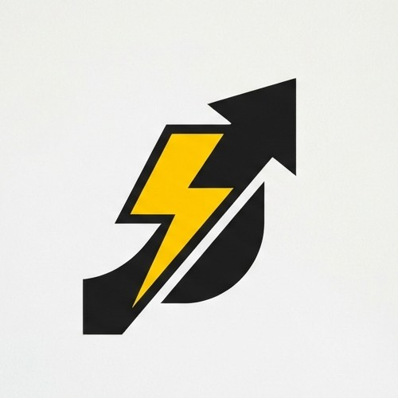
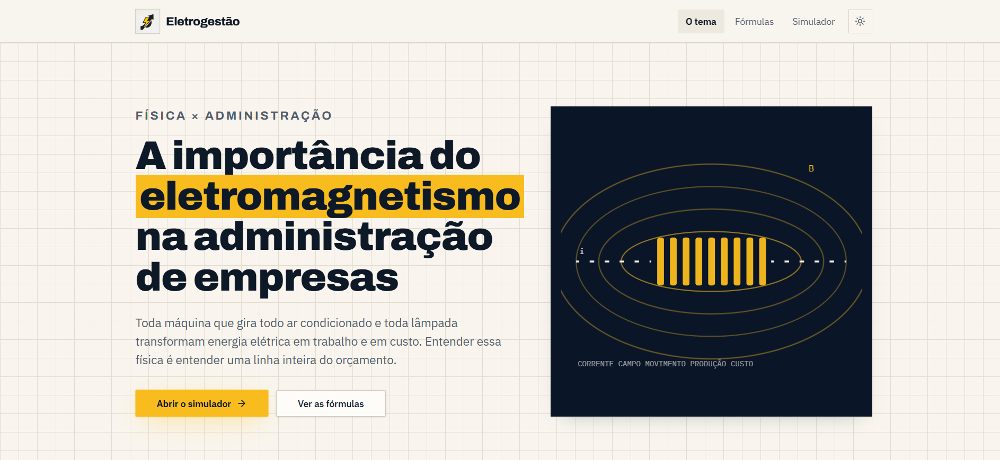
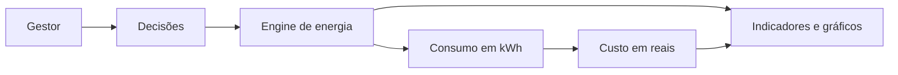
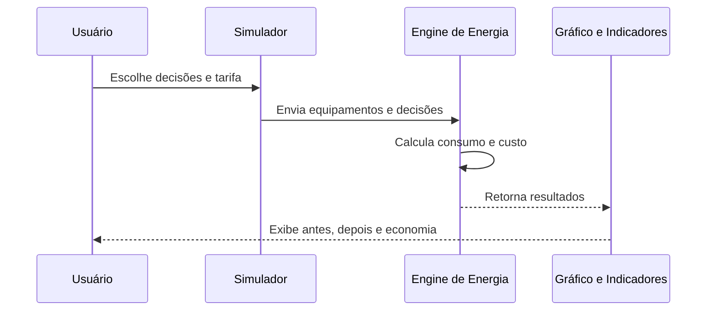

<p align="center"><a href="https://github.com/Carlos2505dev/eletrogestao" target="_blank"></a></p>

<p align="center">
<a href="https://github.com/Carlos2505dev/eletrogestao"></a>
<a href="https://github.com/Carlos2505dev/eletrogestao"></a>
<a href="https://github.com/Carlos2505dev/eletrogestao"></a>
</p>

<p align="center">
<a href="https://skillicons.dev">
  
</a>
</p>

## Sobre o Projeto

**Como a Física pode ajudar uma empresa a gastar menos energia?**

A conta elétrica deixa de ser apenas um número da fatura quando o gestor entende o que acontece dentro de motores, fornos, aparelhos de ar-condicionado, lâmpadas e computadores. O EletroGestão conecta o eletromagnetismo à administração por meio de conceitos, fórmulas e um simulador empresarial.

A aplicação apresenta situações reais da gestão industrial e permite comparar o consumo mensal antes e depois de decisões como trocar equipamentos, reduzir o tempo de funcionamento, desligar máquinas ociosas, melhorar o planejamento da produção e investir em manutenção.

Tudo acontece no navegador, com indicadores financeiros, consumo em kWh, economia líquida, retorno do investimento e uma nota de análise gerencial.

**Experimente:** [Site](https://github.com/Carlos2505dev/eletrogestao) · sem criar conta

## ✨ O que o Projeto faz

A plataforma hoje:

| Recurso | O que resolve | Status |
| --------------------------------- | ------------------------------------------------ | --------------------- |
| **Conteúdo sobre eletromagnetismo** | Relaciona motores, transformadores, medidores e sensores à gestão | ✅ Pronto |
| **Fórmulas didáticas** | Ensina consumo de energia e custo em kWh | ✅ Pronto |
| **Simulador interativo** | Compara consumo e custo antes e depois das decisões | ✅ Pronto |
| **Decisões gerenciais** | Permite combinar cinco estratégias de eficiência | ✅ Pronto |
| **Análise financeira** | Calcula investimento, economia líquida e payback | ✅ Pronto |
| **Gráfico comparativo** | Visualiza o consumo mensal por equipamento | ✅ Pronto |
| **Nota de gestão** | Avalia economia, finanças e preservação da operação | ✅ Pronto |
| **Tema claro e escuro** | Ajusta a aparência da aplicação | ✅ Pronto |
| **Sincronização em nuvem** | Guarda cenários em uma conta | 🗺️ Planejado |

<details>
<summary><strong>📋 Ver todos os recursos</strong></summary>

### Conteúdo

* Motores elétricos e força de Lorentz
* Transformadores e Lei de Faraday
* Medidores de energia e indução eletromagnética
* Sensores, comunicação e automação
* Relação entre Física, planejamento e orçamento

### Simulador

* Troca por equipamentos mais eficientes
* Redução ajustável do tempo de funcionamento
* Desligamento de máquinas ociosas
* Melhoria no planejamento da produção
* Contrato de manutenção com custo mensal
* Configuração da tarifa de energia

### Análise

* Consumo mensal em kWh
* Custo antes e depois em reais
* Percentual de redução
* Economia líquida mensal e anual
* Investimento e tempo de retorno
* Avaliação da operação preservada

</details>

## 🎬 Demonstração

<p align="center">
  
</p>

<div style="display:flex;gap:14px;border-left:4px solid hsl(224 75% 50%);padding:12px 16px;border-radius:6px;background:transparent;align-items:flex-start">
  <div style="flex:0 0 44px;display:flex;align-items:center;justify-content:center">
    <div style="width:36px;height:36px;border-radius:8px;background:hsl(224 75% 95%);display:flex;align-items:center;justify-content:center;color:hsl(224 75% 50%);font-weight:700">
      <svg xmlns="http://www.w3.org/2000/svg" width="18" height="18" viewBox="0 0 24 24" fill="none" stroke="hsl(224 75% 50%)" stroke-width="2" stroke-linecap="round" stroke-linejoin="round" aria-hidden="true"><rect x="3" y="3" width="18" height="18" rx="2" ry="2"></rect><path d="M12 8v4"></path><path d="M12 16h.01"></path></svg>
    </div>
  </div>
  <div style="min-width:0">
    <div style="font-weight:600;color:hsl(224 75% 46%);margin-bottom:4px">Importante</div>
    <div>O EletroGestão usa dados de uma empresa fictícia para fins didáticos. Os resultados ajudam a compreender o impacto das decisões, mas não substituem uma auditoria energética profissional.</div>
  </div>
</div>

## 📦 Instalação

### Pré-requisitos

```text
Node.js >= 18
npm ou bun
```

### Instalação

```bash
git clone https://github.com/Carlos2505dev/eletrogestao.git

cd eletrogestao

npm install
# ou
bun install

npm run dev
```

Abra:

```text
http://localhost:4009
```

## 🚀 Primeiros Passos

### 1. Estude o tema

Na página **O tema**, conheça de forma objetiva como o eletromagnetismo aparece em motores, transformadores, medidores e sistemas de automação.

### 2. Entenda as fórmulas

Em **Fórmulas**, revise o cálculo de energia elétrica e de custo com um exemplo industrial.

### 3. Simule decisões

Em **Simulador**, configure a tarifa e escolha quais estratégias serão aplicadas à empresa fictícia.

### 4. Compare os resultados

Use o botão **Verificar análise** para consultar consumo, custo, economia, retorno e nota gerencial.

A partir daí:

```text
Medir potência e tempo
    ↓
Calcular consumo em kWh
    ↓
Calcular o custo
    ↓
Comparar decisões
    ↓
Escolher o cenário mais eficiente
```

## 🧠 Como Funciona

O consumo mensal de um equipamento é calculado pela potência, pelo tempo de funcionamento e pela quantidade de unidades:

```text
E = (P × t) / 1000

Custo = Consumo (kWh) × Tarifa
```

Por exemplo, um motor de 7.500 W funcionando 16 horas por dia durante 22 dias por mês consome:

```text
t = 16 × 22 = 352 h
E = (7.500 × 352) / 1000 = 2.640 kWh
```

A engine do projeto separa esse cálculo da interface e aplica as decisões da gestão:

```ts
import { cost, energyKWh } from "@/lib/energy";

const consumo = energyKWh(7500, 352);
// → 2640 kWh

const custo = cost(consumo, 0.92);
// → R$ 2.428,80
```

O simulador aplica também fatores de potência eficiente, redução de tempo, máquinas ociosas, planejamento da produção e manutenção:



<details>
<summary><strong>🏗️ Detalhes da arquitetura</strong></summary>

### Componentes

| Componente | Responsabilidade |
| ---------------------------------- | -------------------------------------- |
| `src/routes` | Páginas e definição das rotas |
| `src/components/site` | Cabeçalho, rodapé, fórmulas e elementos visuais |
| `src/components/ui` | Componentes reutilizáveis de interface |
| `src/lib/energy.ts` | Cálculos, cenários, indicadores e nota gerencial |
| `src/lib/utils.ts` | Utilitários compartilhados |
| `public` | Logotipo e arquivos públicos |

### Fluxo de uma interação no simulador



### Decisão: TanStack Start

O projeto utiliza TanStack Start com TanStack Router para organizar as rotas e o servidor da aplicação com React.

### Decisão: TypeScript

O TypeScript mantém explícitos equipamentos, decisões, consumos e resultados. Isso ajuda a detectar erros antes que valores incorretos sejam apresentados ao usuário.

</details>

## 🗂️ Estrutura do Projeto

```text
eletrogestao/
├── public/
│   ├── favicon.ico
│   ├── logo.jpg
│   └── robots.txt
├── scripts/
├── src/
│   ├── components/
│   │   ├── site/
│   │   └── ui/
│   ├── lib/
│   ├── routes/
│   │   ├── __root.tsx
│   │   ├── index.tsx
│   │   ├── formulas.tsx
│   │   └── simulador.tsx
│   ├── styles.css
│   └── entry-client.tsx
├── index.html
├── package.json
├── tsconfig.json
├── vite.config.ts
├── vitest.config.ts
└── README.md
```

<details>
<summary><strong>📁 Explicação da estrutura</strong></summary>

| Caminho | Objetivo |
| ----------------------------- | ----------------------------------------- |
| `src/routes` | Páginas, títulos e rotas da aplicação |
| `src/components/site` | Componentes específicos do site |
| `src/components/ui` | Botões, inputs, switches e controles |
| `src/lib/energy.ts` | Fórmulas e lógica do simulador |
| `src/lib/utils.ts` | Funções utilitárias |
| `public` | Imagens e arquivos estáticos |
| `scripts` | Scripts auxiliares de build e limpeza |

### Arquitetura

O EletroGestão separa a apresentação da lógica de cálculo:

| Camada | Diretórios | Responsabilidade |
| ---------------- | ------------------------------ | ------------------------------------------- |
| **Apresentação** | `src/routes`, `src/components` | Interface e navegação |
| **Domínio** | `src/lib/energy.ts` | Fórmulas, cenários e indicadores |
| **Estado** | Rotas do simulador | Decisões temporárias e resultado atual |
| **Contratos** | Interfaces em `src/lib/energy.ts` | Tipos compartilhados de equipamentos e decisões |

**Por que essa arquitetura?**

- **Manutenibilidade**: a interface pode evoluir sem alterar as fórmulas.
- **Testabilidade**: os cálculos podem ser testados isoladamente.
- **Separação de responsabilidades**: páginas, componentes e regras possuem funções distintas.
- **Escalabilidade**: novos equipamentos, decisões e indicadores podem ser adicionados.

</details>

## ⚙️ Configurações Avançadas

<details>
<summary><strong>🔧 Variáveis de ambiente</strong></summary>

O projeto não exige variáveis de ambiente para executar o cenário padrão.

</details>

<details>
<summary><strong>🧪 Lint e build</strong></summary>

Lint:

```bash
npm run lint
```

Testes:

```bash
npm test
```

Type-check:

```bash
npx tsc --noEmit
```

Build de produção:

```bash
npm run build
```

Preview do build:

```bash
npm run preview
```

</details>

## ⚠️ Limitações técnicas conhecidas

Estas limitações descrevem o comportamento atual da plataforma:

| Área | Limitação atual |
| ---- | --------------- |
| **Dados** | Os equipamentos, potências, tarifas e custos iniciais representam uma empresa fictícia. |
| **Cálculo numérico** | Os cálculos são aproximados para fins didáticos e não substituem uma auditoria energética profissional. |
| **Preço da energia** | A tarifa pode ser ajustada manualmente; impostos, bandeiras e contratos específicos não são modelados em detalhe. |
| **Persistência** | Decisões e cenários são mantidos apenas durante a sessão da página. Não há conta ou banco de dados configurado. |
| **Escopo físico** | Transformadores, fatores de potência e perdas específicas do cabeamento não são simulados automaticamente. |

## 📚 Documentação

| Documento | Descrição |
| ------------------------- | ------------------ |
| [README](./README.md) | Visão geral |
| [Documentação](./docs/README.md) | Índice da documentação |
| [Tema](./docs/tema.md) | Conteúdo sobre eletromagnetismo |
| [Fórmulas](./docs/formulas.md) | Cálculos didáticos |
| [Simulador](./docs/simulador.md) | Interface e fluxo de decisões |
| [Engine](./docs/engine.md) | Implementação dos cálculos |

## 🤝 Contribuindo

Todo tipo de contribuição é bem-vinda: correção de bug, novo equipamento, melhoria de interface ou documentação.

1. Faça um fork do projeto
2. Crie sua Feature Branch (`git checkout -b feature/AmazingFeature`)
3. Faça commit das mudanças (`git commit -m 'Add some AmazingFeature'`)
4. Envie para a branch (`git push origin feature/AmazingFeature`)
5. Abra um Pull Request

## 🐛 Reportando Problemas

Abra uma [Issue](https://github.com/Carlos2505dev/eletrogestao/issues/new) contendo:

```text
### Descrição

Explique o problema.

### Como reproduzir

1. ...
2. ...
3. ...

### Resultado esperado

...

### Ambiente

- Sistema operacional:
- Navegador:
- Versão da aplicação:
```

## ❓ FAQ

<details>
<summary><strong>O EletroGestão é gratuito?</strong></summary>

O projeto é uma aplicação web acadêmica e pode ser executado diretamente a partir do repositório.

</details>

<details>
<summary><strong>Preciso criar uma conta para usar?</strong></summary>

Não. O simulador funciona sem autenticação.

</details>

<details>
<summary><strong>Como o consumo é calculado?</strong></summary>

Usamos `E = (P × t) / 1000`, em que `P` é a potência em watts, `t` é o tempo em horas e `E` é o consumo em kWh.

</details>

<details>
<summary><strong>Como o custo é calculado?</strong></summary>

O consumo em kWh é multiplicado pela tarifa configurada em reais por kWh.

</details>

<details>
<summary><strong>Os resultados representam uma empresa real?</strong></summary>

Não. Todos os equipamentos e valores formam um cenário fictício para fins educacionais.

</details>

<details>
<summary><strong>O simulador substitui uma auditoria energética?</strong></summary>

Não. Ele demonstra relações básicas entre potência, tempo, consumo e custo. Medições reais e análises técnicas continuam necessárias em uma empresa.

</details>

## 💙 Agradecimentos

Obrigado aos estudantes que participaram da construção do Eletrogestão e todos os envolvidos na apresentação desse material, que torna possível relacionar a Física com decisões administrativas.

<div align="center">

  

  <p><em>Da Física à decisão: medir, calcular e economizar.</em></p>

  <p>
    <a href="https://github.com/Carlos2505dev/eletrogestao"></a>
  </p>

  <p>
    <a href="https://github.com/Carlos2505dev/eletrogestao">GitHub</a>
  </p>

  <p><a href="#readme">⬆ Voltar ao topo</a></p>

</div>
